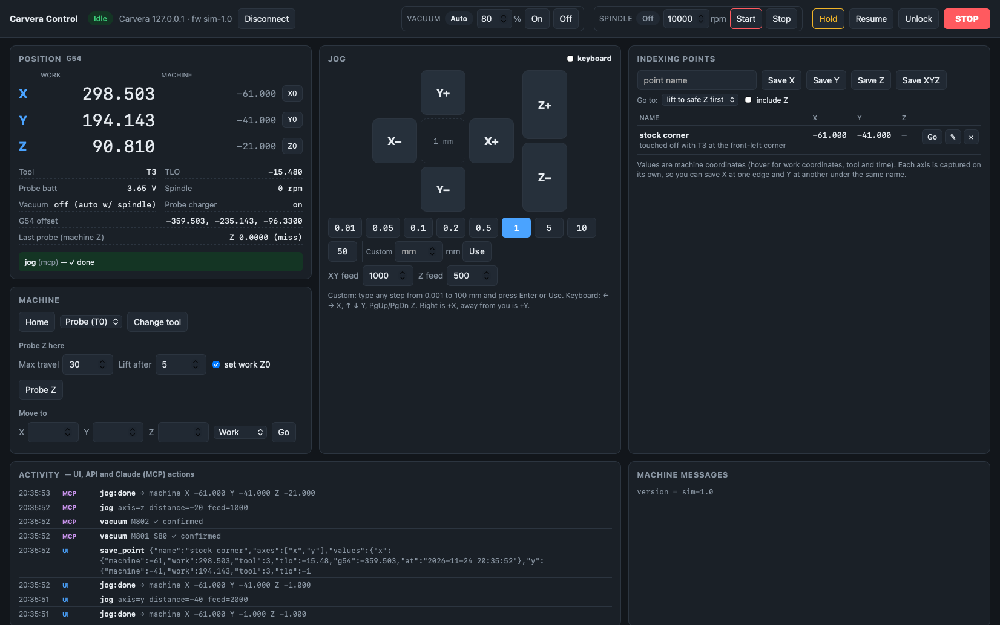
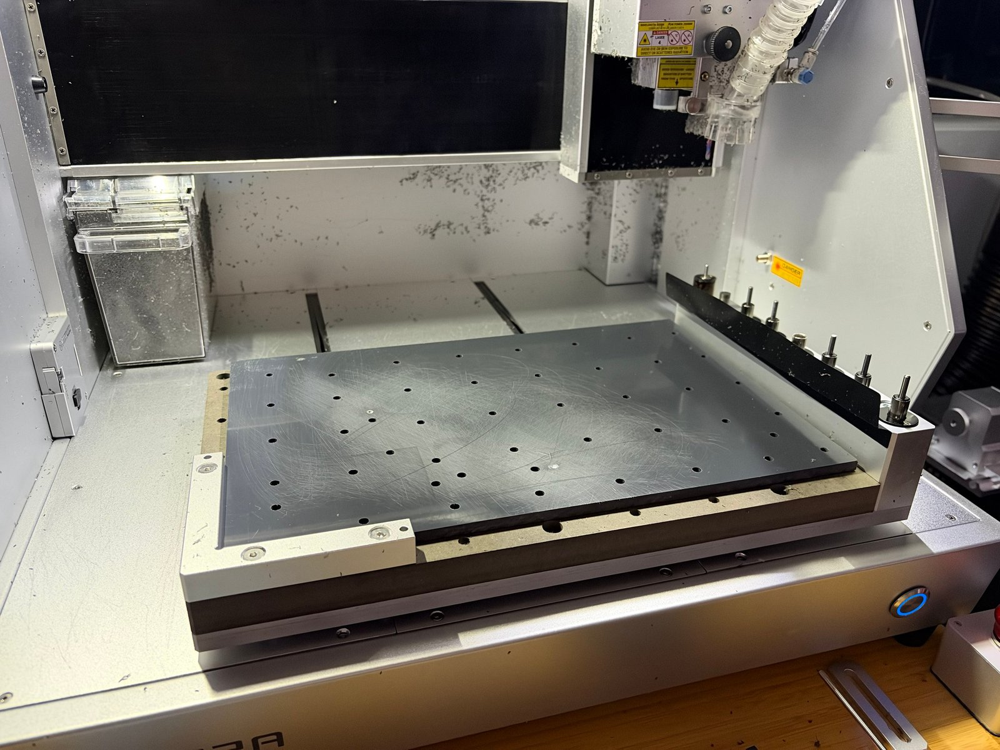

# Carvera AI

**Run a Makera Carvera CNC from a plain-text conversation with an AI agent.**

Carvera AI is three things in one repository:

1. **Carvera Control**: a small local server for the Makera Carvera C1 (firmware 1.0.3). It holds the
   machine's single Wi-Fi connection and gives it a web UI for jogging and indexing, a JSON HTTP API,
   an MCP server for AI agents, a program uploader/runner with a kill switch, onboard vacuum and spindle
   switches, and a full machine simulator for tests.
2. **The Carvera AI skill**: a `SKILL.md` playbook plus two helper commands. It teaches an agent
   (Claude, Codex, Grok, Cursor, ...) how to drive the machine safely: what to read first, how the
   firmware behaves, the safety rules, indexing math, probing, leveling and running jobs.
3. **A machine kit for the Carvera C1**: a spoilboard drawing, a ready-to-run spoilboard hole program
   and its generator, offline auto-leveling tools, and a script that fetches Makera's own 3D models.



You position the machine in the web UI (jog, touch off edges, save indexing points). The agent sees
what you did through the activity log, does the planning and the math, and acts on the machine when you
ask it to, through the same server. Every action is logged with its source (`ui`, `mcp`, `api`).

```
 web UI (you) ───┐
 AI agent (MCP) ─┼── HTTP 127.0.0.1:17916 ── Carvera Control ── TCP 2222 ── Makera Carvera
 scripts / curl ─┘    activity log, points,                     UDP 3333 discovery
                      jobs, interlocks
```

> **Safety.** This software moves a real machine with a spinning cutter. It is not affiliated with or
> endorsed by Makera. The STOP button in the UI and API is a software stop; the machine's E-stop is the
> real one. Read [docs/SAFETY.md](docs/SAFETY.md) before connecting an agent to a machine.

---

## Featured: a new spoilboard, made from one conversation

[](machines/makera-carvera-c1/spoilboard/)

**[How to build this spoilboard →](machines/makera-carvera-c1/spoilboard/)**

A 335 × 225 mm sheet of 1/4" PVC laid over the stock bed and pushed into the anchor 1 corner. The agent
lined the holes up with Makera's bed pattern from Makera's CAD, added two dowel holes for locating
fixtures, routed the tool around the anchor block, and cut all 48 holes in 11 minutes. The folder has
the drawing, the ready-to-run program, a generator for other sheet thicknesses and hole sizes, and a
prompt to paste into your agent.

---

## What an agent can do with it

Working examples from the reference machine, all driven by conversation:

- **"Probe the stock and run my file."** The agent loads the probe, probes Z, puts the probe back so it
  seats on its charger, uploads the program over XMODEM, checks the machine's MD5, shows a preflight,
  and runs the program from the machine's SD card after your "go". A Wi-Fi drop does not stop the cut.
  While it runs, the agent watches progress, keeps the vacuum on, and trips a kill switch if the tool
  leaves the program's envelope.
- **"Level it, 5×5."** The agent probes a leveling grid (`M495`), reads it back (`M375.1`), checks the
  grid for bad points, writes a leveled copy of the program (bilinear inside the grid, extrapolated
  outside), verifies the copy move by move, and runs it.
- **"Index off these edges."** You touch off with the cutting tool and save points in the UI. The agent
  turns those tool-centre touch-offs into an X/Y shift for the CAM program and verifies the mapping.
- **"Make me a new spoilboard."** The agent generated every hole of Makera's stock bed pattern from
  Makera's CAD, routed around the anchor block, wrote the program and the drawing, and cut it
  ([files and how-to](machines/makera-carvera-c1/spoilboard/)).
- **"Turn the vacuum on" / "start the spindle at 12000."** Switches with read-back confirmation from the
  machine.

### From text to a finished part with Autodesk Fusion

Add **Autodesk Fusion's MCP server** next to Carvera AI and the whole chain runs from conversation:

1. **Model**: the agent builds or edits the part in Fusion from your description (sketches, extrudes,
   holes, fillets) through the Fusion API.
2. **CAM**: it creates the setup (stock, WCS at the stock's top-front-left) and the toolpaths (adaptive,
   contour, pocket, drill) with the Carvera tool library, and posts with Makera's `Carvera.cps`.
3. **Check**: it fixes what the post leaves out (onboard vacuum `M801`), analyzes extents and Z, and
   replays the program against the site rules (dowel zones, anchor keep-out) before anything uploads.
4. **Index and make**: it probes and levels the stock, uploads, preflights, and runs the part on the
   Carvera with your go.

Details, setup and the known limits (for example, Fusion's Personal license refuses tool changes in one
post and slows rapids to the cutting feed) are in [docs/FUSION-WORKFLOW.md](docs/FUSION-WORKFLOW.md).

---

## Compatible agents and harnesses

Carvera AI talks three standard ways, so any of these can act as a **controller** (moves the machine
when you ask) or a **monitor** (reads status, jobs and the activity log):

| Harness | Skill (`SKILL.md`) | MCP server | HTTP API / `carvera-api` | Status |
|---|---|---|---|---|
| **Claude Code** (Anthropic) | yes: `~/.claude/skills/carvera-ai` | yes | yes | tested end to end on the reference machine |
| **Claude Desktop** | via a project or instructions | yes | — | compatible by protocol |
| **OpenAI Codex CLI** | Agent Skills folder, or point `AGENTS.md` at `SKILL.md` | yes (`~/.codex/config.toml`) | yes | compatible by protocol |
| **Grok CLI** (xAI) | reads `~/.claude/skills` | yes | yes | compatible by protocol |
| **Cursor** | `~/.cursor/skills` | yes (`mcp.json`) | yes | compatible by protocol |
| **Gemini CLI** (Google) | point `GEMINI.md` at `SKILL.md` | yes (`settings.json`) | yes | compatible by protocol |
| **VS Code agent mode, Windsurf, Cline, Zed, Continue** | as instructions/rules | yes | yes | compatible by protocol |
| **Any agent that can run shell commands** | as instructions | — | yes | compatible by protocol |

"Compatible by protocol" means the harness supports the interface (MCP over stdio, HTTP, or shell);
only Claude Code has been run against the real machine so far. Setup for each one is in
[docs/HARNESSES.md](docs/HARNESSES.md).

---

## Quick start

Requirements: Python 3.10+ (the server uses only the standard library), a Carvera on your Wi-Fi, and
optionally the `mcp` Python package for the MCP server (`pip install -r requirements-mcp.txt`).

```sh
git clone https://github.com/BlinkingSun/carvera-ai.git
cd carvera-ai
python3 -m carvera_control           # then open http://127.0.0.1:17916/ and press Connect
```

- On macOS you can double-click **`Carvera Control.command`** instead.
- Close CarveraController first (the machine takes one connection at a time). **Disconnect** hands it back.
- With no machine configured, Carvera Control connects to the Carvera it hears on UDP 3333. To pin a
  machine, set `"host"` in `data/config.json` (created on first run) or start with `--machine <ip>`.
- No machine handy? `python3 sim/carvera_sim.py` in one terminal and `python3 -m carvera_control --sim`
  in another give you a simulated Carvera.

Install the skill for Claude Code (other harnesses: [docs/HARNESSES.md](docs/HARNESSES.md)):

```sh
ln -s "$PWD/skill/carvera-ai" ~/.claude/skills/carvera-ai
mkdir -p ~/.local/bin && ln -s "$PWD/skill/carvera-ai/bin/carvera-open" "$PWD/skill/carvera-ai/bin/carvera-api" ~/.local/bin/
claude mcp add carvera --scope user -- python3 "$PWD/mcp/carvera_mcp.py"
```

Then, in Claude Code: `/carvera-ai what state is the machine in?`

Before the first real job, edit **`site-rules.txt`** for your machine (it ships with the reference
setup's dowel and anchor rules), and read [docs/SAFETY.md](docs/SAFETY.md).

---

## Web UI

- **Position**: work and machine coordinates, tool and TLO, probe battery, spindle rpm, vacuum, probe
  charger, G54 and the last probe result, with per-axis zero buttons.
- **Jog**: pad and keyboard jog (← → X, ↑ ↓ Y, PgUp/PgDn Z), steps from 0.01 to 50 mm plus a **custom
  step** (0.001–100 mm), separate XY and Z feeds. Feed moves only.
- **Machine**: Home, ATC tool change (the probe is put away with a deeper stow so it seats on its
  charger), Probe Z here (fast touch, back off, slow re-touch, optional work Z0), Move to (work or
  machine coordinates; Z goes first when rising and last when lowering).
- **Indexing points**: save X, Y and Z separately under one name (X at one edge, Y at another), with
  machine and work coordinates, tool, TLO and G54. Go to a point at the current height or after lifting.
- **Header**: connection, onboard **vacuum** (power %, On/Off, confirmed by the machine), **spindle**
  (rpm, Start with confirmation, Stop; refused with the probe or an empty spindle and while a program
  runs; you can keep jogging while it turns, for manual control), Hold, Resume, Unlock and STOP.
- **Activity and machine messages**: everything you, the agent and the system did, and everything the
  machine printed.

## Repository map

| Path | What it is |
|---|---|
| `carvera_control/` | The server (standard library only). `machine.py` = connection, status parsing, operations (jog, move, home, tool change with deep probe stow, probe, zero, raw G-code, vacuum, spindle, upload/run). `program.py` = program analysis, XMODEM upload, run with kill switch. `server.py` = HTTP API, jobs, config. `store.py` = activity log and saved points. |
| `web/` | The web UI (`index.html`, `app.js`, `style.css`), served by the server. No build step. |
| `mcp/carvera_mcp.py` | MCP server (stdio) exposing the API as 24 tools for agents. Starts the server if it isn't running. |
| `skill/carvera-ai/SKILL.md` | The Carvera AI skill: the agent's playbook for this machine. |
| `skill/carvera-ai/bin/carvera-open` | Starts the server, connects, opens the UI and prints the machine context (state, offsets, site rules, points, activity) for the agent. |
| `skill/carvera-ai/bin/carvera-api` | `carvera-api METHOD /path [json]`: calls the API as the agent; POSTs wait for the job. |
| `site-rules.txt` | Your machine's hard rules (no-go zones, keep-outs). Printed by `carvera-open` every session. Ships with the reference setup's rules. |
| `sim/carvera_sim.py` | A Carvera simulator (status, ATC, probing, XMODEM upload, SD playback, vacuum, spindle, tool rack, alarms) that mimics firmware 1.0.3's quirks. |
| `tests/` | End-to-end tests against the simulator: `test_e2e.py` (UI/API flow, vacuum, probe stow, spindle), `test_program.py` (upload, run, kill switch), `test_mcp.py` (MCP tools). |
| `tools/spoilboard_holes.py` | Generates the spoilboard hole program from Makera's C1 bed pattern, routed around the anchor. |
| `tools/spoilboard_drawing.py` | Draws the A3 spoilboard PDF from the hole program. |
| `tools/leveling/` | Offline auto-leveling: parse a probed grid, level a program, verify the result. See [docs/LEVELING.md](docs/LEVELING.md). |
| `machines/makera-carvera-c1/` | The machine kit: facts, the spoilboard (drawing, program, layout, README with a copy-paste prompt) and the 3D-model fetch script. |
| `docs/` | API, firmware notes, safety, harness setup, Fusion workflow, leveling. |
| `Carvera Control.command` | macOS double-click launcher. |
| `data/` (created at runtime, git-ignored) | Your `config.json`, activity log, saved points and server log. |

## Documentation

- [docs/API.md](docs/API.md): every endpoint, the config keys and how jobs work.
- [docs/SAFETY.md](docs/SAFETY.md): interlocks, the kill switch, site rules, and the agent's rules.
- [docs/HARNESSES.md](docs/HARNESSES.md): setup for Claude Code, Codex, Grok, Cursor, Gemini and other MCP clients.
- [docs/FUSION-WORKFLOW.md](docs/FUSION-WORKFLOW.md): text to model to CAM to finished part.
- [docs/LEVELING.md](docs/LEVELING.md): how the Carvera's leveling really works, and offline leveling.
- [docs/FIRMWARE-NOTES.md](docs/FIRMWARE-NOTES.md): firmware 1.0.3 protocol facts found on the real machine.
- [machines/makera-carvera-c1/README.md](machines/makera-carvera-c1/README.md): the C1 kit.

## Tests

```sh
python3 tests/test_e2e.py         # simulator <- server <- HTTP API: full flow, vacuum, probe stow, spindle
python3 tests/test_program.py     # analyze, XMODEM upload (NAK, busy), md5, play with tool changes, kill switch
python3 sim/carvera_sim.py & python3 -m carvera_control --sim --port 17999 --data /tmp/cc-mcp & \
  python3 tests/test_mcp.py 17999 # MCP tools over stdio (needs the mcp package)
```

## Credits and license

- Makera's machine models, bed drawing and the `Carvera.cps` post live in
  [MakeraInc/CarveraProfiles](https://github.com/MakeraInc/CarveraProfiles). They are not redistributed
  here (that repository has no license); `machines/makera-carvera-c1/3d-model/fetch_makera_models.sh`
  downloads them from the source.
- The Carvera firmware is Smoothieware-based; the protocol notes come from testing firmware 1.0.3.
- Carvera AI is released under the [MIT License](LICENSE). Not affiliated with Makera, Anthropic,
  OpenAI, xAI, Google, Cursor or Autodesk.
