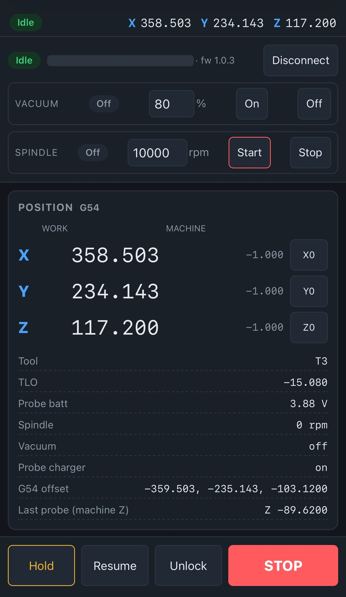

# Phone and tablet control

Run the Carvera from your phone or tablet while you stand at the machine: jog, zero, change tools,
probe, switch the vacuum and spindle, save indexing points, and hit STOP. The phone uses the same web
UI, laid out for a touch screen.



```
 phone / tablet ── Wi-Fi ── computer running Carvera Control ── Wi-Fi ── Carvera
   (paired)        :17917     (keeps the machine connection)    :2222
```

The phone talks to the computer, and the computer talks to the machine (the Carvera accepts one
connection at a time). So the computer has to be running Carvera Control and stay awake.

## Set it up with your agent (recommended)

Paste this into your agent (Claude Code, Codex, Grok, Cursor, Gemini, ...):

```text
/carvera-ai Set up phone control for me. Turn on phone and tablet access in Carvera Control, give me
the address to open on my phone and the pairing code, wait until my phone shows up as paired, then
tell me how to add it to my Home Screen. If my phone can't reach it, troubleshoot with me.
```

Without the skill installed, start with: `Read skill/carvera-ai/SKILL.md in the carvera-ai repository,
then set up phone control for me ...`. The skill's "Phone and tablet setup" section is the script the
agent follows. It turns access on through the API, reads you the address and code, watches for the
pairing, and walks you through the troubleshooting below.

## Set it up by hand

1. Start Carvera Control on the computer and open the UI (`http://127.0.0.1:17916/`).
2. Click **Phone** in the header, then **Turn on**. The dialog shows:
   - the addresses to open, for example `http://<computer-name>.local:17917/` and
     `http://<computer-ip>:17917/` (the `.local` name keeps working when the router hands out a new IP);
   - a **6-digit pairing code**.
3. On the phone or tablet, on the **same Wi-Fi**, open one of the addresses in the browser.
4. Enter the code and tap **Pair**. The device appears under "Paired devices" in the dialog, and the
   phone shows the controls.

The choice is saved: Carvera Control turns phone access back on at its next start. Turn it off in the
same dialog. `python3 -m carvera_control --remote` turns it on for one run.

### Add it to the Home Screen

- **iPhone / iPad (Safari):** Share → **Add to Home Screen**. The icon opens full screen, like an app.
  iOS keeps Home Screen apps' cookies apart from Safari, so the icon may ask for a code once: get a
  fresh one from the dialog.
- **Android (Chrome):** menu ⋮ → **Add to Home screen** (or **Install app**).

## Using it

- **Top strip** (phones): machine state and work X / Y / Z stay in view while you scroll.
- **Bottom bar** (phones): **Hold**, **Resume**, **Unlock** and **STOP**, always in reach.
- **Jog pad** fills the width; steps from 0.01 to 50 mm plus a custom step.
- Tap a saved point's X / Y / Z value to see its work coordinates, tool and time.
- Tablets get the two-column layout with larger touch targets.
- Everything a phone does is logged with source **`remote`**, so your agent knows you are at the
  machine with a phone.

**STOP on the phone is a software stop over Wi-Fi.** The machine's E-stop is the real one.

## What a phone can and cannot do

A paired device gets the controls on the web page: connect / disconnect, jog, move to, home, tool
change, probe Z, set zero, unlock, hold / resume / stop, vacuum, spindle and indexing points.

These stay on the computer and answer 403 from a phone: raw G-code, uploading and running programs
(they take file paths on the computer), machine discovery, and the phone-access settings (turning it
on or off, the pairing code, forgetting devices).

## Security

- **Off by default.** The main port (17916) only ever answers on 127.0.0.1. Phone access is a second
  port (17917) that exists only while it is turned on.
- **Pairing.** The 6-digit code changes after every pairing and after 5 wrong tries, so it cannot be
  guessed by trying codes. A paired device keeps a cookie (HttpOnly, SameSite=Strict, one year). The
  computer stores only the cookie's SHA-256, in `data/devices.json`.
- **Forget** one device or all of them in the dialog; their cookies stop working at once.
- **Plain HTTP.** Traffic on the Wi-Fi is not encrypted. Someone who can capture your Wi-Fi traffic
  could copy a device cookie and use it while phone access is on. Use it on your own network, turn it
  off when you are done, and forget devices you no longer use.
- **The 127.0.0.1 port is protected from web pages:** it refuses requests whose `Host` is not
  127.0.0.1 / localhost (DNS rebinding) and POSTs from another site's page (`Origin` check).

## Troubleshooting

| Symptom | Fix |
|---|---|
| The phone's browser can't open the address | Same Wi-Fi as the computer? Guest networks often isolate devices from each other. Try the IP address instead of the `.local` name (some Android phones don't resolve `.local`). |
| It worked, then stopped | The computer went to sleep, or Carvera Control was closed. Keep the computer awake while you work. |
| A firewall prompt, or nothing answers | **macOS:** click **Allow** when macOS asks whether Python may accept incoming connections, or add Python in System Settings → Network → Firewall → Options. **Windows:** allow Python on private networks when Defender asks. **Linux:** `sudo ufw allow 17917/tcp`. |
| "Wrong code" | Codes change after every pairing and after 5 wrong tries. Read the current one from the dialog. |
| The Home Screen icon asks for a code | Normal on iOS the first time (separate cookie storage). Pair it once with a fresh code. |
| "cannot listen on port 17917" | Another program uses the port. Set `"remote_port"` in `data/config.json` and restart. |
| A button says "not available from a phone or tablet" | Raw G-code, programs and phone-access settings are computer-only by design. |
| The phone shows "Server down" | Carvera Control on the computer stopped or restarted. Reload the page once it is back. |

## Reference

- Config (`data/config.json`): `"remote"` (on at start, saved by the dialog), `"remote_port"` (17917).
- API: `GET /api/remote`, `POST /api/remote {on}`, `POST /api/remote/forget {id?}` on 127.0.0.1;
  `POST /api/pair {code, name}` on the phone port. See [API.md](API.md#phone-and-tablet-access).
- Code: `carvera_control/remote.py` (listener, pairing, allowlist), `web/` (layout, pairing screen,
  `manifest.webmanifest`, icons). Tests: `tests/test_e2e.py` test_05_phone_access.
